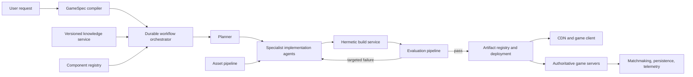

# Production Game Generation Architecture

## Objective

Build a platform that can reliably generate and operate increasingly ambitious games. The practical target should advance in verified tiers:

1. Polished local and turn-based browser games.
2. Small authoritative online games such as social deduction, arena, and co-op games.
3. Specialized large-world or competitive games built on mature domain runtimes.

"Generate any Minecraft- or PUBG-scale game from one prompt" is not a credible first milestone. Those products combine years of engine, networking, content, security, operations, and playtesting work. The platform can eventually generate games in those categories by assembling and customizing proven subsystems, but it must not generate those subsystems from scratch for each game.

## Core Decisions

- Use Godot as the client and presentation runtime.
- Keep game rules deterministic and independent from UI where possible.
- Use authoritative servers for persistent, competitive, or cheat-sensitive games.
- Treat components as versioned products with owners, tests, compatibility metadata, and migration policies.
- Treat LLM output as untrusted input that must pass deterministic gates.
- Store plans, source, assets, builds, evaluations, and deployments as separate versioned artifacts.
- Never use chat history as the system of record.
- Never use an LLM's self-reported smoke result as the only proof of playability.
- Select a domain runtime for complex genres instead of asking the model to invent one.

## Platform Shape

The generation control plane ends when it publishes immutable, signed artifacts. The runtime data plane starts when players connect. E2B is appropriate for isolated generation and testing; it is not the production game host.

## Typed Planning Contract

Before code generation, compile the user request into a versioned `GameSpec` containing:

- Product intent, target audience, platforms, and session length.
- Core loop, rules, win/loss conditions, game states, and edge cases.
- Player count, local/online mode, authority model, reconnect policy, and latency budget.
- Camera, controls, accessibility, visual direction, audio direction, and content budget.
- Required components with pinned versions.
- Performance budgets for frame time, memory, package size, network bandwidth, and server tick.
- Security and trust boundaries.
- Acceptance tests and measurable fun/quality hypotheses.

The planner converts that specification into a dependency graph, not prose alone. Every task declares inputs, outputs, owner agent, validation command, and rollback point. Store the specification and graph in the database and object storage so work can resume after process restarts.

## Knowledge Service

Replace general search during every turn with a curated, versioned retrieval service:

- Pin official Godot documentation to the exact engine version used by the build image.
- Index the official [Godot demo projects](https://github.com/godotengine/godot-demo-projects) by engine version and subsystem.
- Index approved component documentation, architecture decisions, test examples, and prior successful game patterns.
- Record source URL, commit SHA, license, engine compatibility, ingestion date, and extracted API symbols.
- Require an allowlist and license review before repository code can be reused.
- Retrieve small API-level passages for the current task instead of adding entire documents to the model context.
- Run freshness jobs and compatibility tests before promoting new documentation snapshots.

Useful primary references include Godot's [stable documentation](https://docs.godotengine.org/en/stable/), its [official demos](https://github.com/godotengine/godot-demo-projects), and the official [Godot source and documentation organization](https://github.com/godotengine). External repositories are evidence and design references, not automatically trusted dependencies.

## Component Platform

Each reusable component should be a standalone Godot addon or server package with:

- Semantic version, engine compatibility range, ownership, and license.
- Public API and event contracts.
- Serialization version and migration support.
- Unit, integration, determinism, fuzz, performance, and multiplayer tests where applicable.
- Example scene and minimal reference integration.
- Explicit client/server authority and security rules.
- Benchmarks and supported scale limits.
- Deprecation policy and automated compatibility checks.

Priority component families:

- Input, camera, character controller, abilities, animation state, and interaction.
- Turn, cards, inventory, items, crafting, quests, dialogue, and save games.
- Lobby, party, matchmaking adapter, replication, prediction, reconciliation, reconnect, and anti-cheat hooks.
- World chunks, procedural generation, persistence, navigation, spawning, interest management, and LOD.
- UI shell, settings, accessibility, localization, telemetry, and crash reporting.

Godot's high-level multiplayer and dedicated-server export are useful foundations, but Godot explicitly does not make gameplay secure automatically. Competitive games require server-owned state and validation. For backend features, evaluate the official Godot 4 [Nakama client](https://github.com/heroiclabs/nakama-godot) and Nakama's [authoritative multiplayer model](https://heroiclabs.com/docs/nakama/concepts/multiplayer/authoritative/). For session-based native servers, use orchestration rather than embedding that responsibility in generated game code.

## Agent Roles

Use a durable workflow with narrow agents and deterministic handoffs:

1. **Requirements agent:** Produces the typed `GameSpec` and lists unresolved product decisions.
2. **Architecture agent:** Selects components, authority model, budgets, and task graph.
3. **Gameplay agent:** Implements deterministic rules and simulation tests.
4. **Client agent:** Implements scenes, controls, camera, UI, feedback, and accessibility.
5. **Networking agent:** Integrates only approved replication and server components.
6. **Asset director:** Produces an asset brief and consistency constraints.
7. **Asset workers:** Generate or assemble models, textures, animation, VFX, UI, music, and sound.
8. **Build agent:** Runs pinned tools in a hermetic image and publishes immutable artifacts.
9. **Evaluator agents:** Inspect test results and propose a bounded repair; they cannot waive failed gates.
10. **Release agent:** Deploys a passed build through staged environments with rollback.

Agents should exchange artifacts and structured reports, not hidden reasoning or growing chat transcripts.

## Staged Component Assembly

Generated games start from a rule-neutral Godot shell and versioned mechanism components, never a
finished genre implementation. The model selects only the mechanisms it needs, then authors the
game-specific data, rules, orchestration, tests, and presentation. For example, a card game can use
card ownership and turn-order components, but it must still define its own deck and gameplay.

Every game follows the same dependency-ordered stages:

1. Define the domain model and pure rule helpers.
2. Configure selected components into a deterministic initial state.
3. Implement legal actions and core state transitions.
4. Add victory, terminal state, and restart behavior.
5. Build a game-specific responsive UI connected to those actions.
6. Add isolated behavioral tests, then build and run the game.

The model plans one stage at a time and may add any functions or project-local files needed by that
stage. The application owns routing, exact source snapshots, transactional edits, validation,
rollback, compilation, and runtime checks. A copied component may be extended only after its source
is read and the extension is included in the frozen stage plan. This keeps the workflow broad enough
for new game types while preventing chat history or model claims from becoming build truth.

## Asset Pipeline

Procedural Godot shapes are enough for prototypes, not professional art direction. Build an asset pipeline that:

- Creates a visual bible with palette, materials, shape language, scale, camera, lighting, and UI rules.
- Uses a curated licensed asset library before generating new assets.
- Produces editable source plus runtime derivatives.
- Uses Blender automation for geometry, rigging, UVs, collision meshes, and LODs.
- Exports glTF/GLB, Godot's recommended 3D interchange path, then validates import logs and scene structure.
- Generates PBR texture sets with fixed resolution and compression budgets.
- Validates topology, skeleton naming, animation loops, pivots, collision, draw calls, texture memory, audio peaks, and licensing metadata.
- Runs visual consistency scoring across all assets in a build.

Godot documents its [3D import pipeline](https://docs.godotengine.org/en/stable/tutorials/assets_pipeline/importing_3d_scenes/index.html) and recommends [glTF 2.0](https://docs.godotengine.org/en/stable/tutorials/assets_pipeline/importing_3d_scenes/available_formats.html) for 3D scenes.

## Evaluation Pipeline

Promotion requires all applicable gates:

- **Schema:** GameSpec and component compatibility validation.
- **Static:** Parse/import, forbidden APIs, ownership boundaries, resource references, and license scanning.
- **Unit:** Deterministic rule, serialization, and component tests using a Godot 4 test framework such as [GdUnit4](https://github.com/godot-gdunit-labs/gdUnit4).
- **Simulation:** Thousands of seeded matches or play traces checking invariants, completion rate, and state hashes.
- **Interaction:** Playwright or native input automation performs real actions through menus and gameplay.
- **Visual:** Golden screenshots, camera framing, contrast, text overflow, animation continuity, and cross-resolution checks.
- **Performance:** CPU/GPU frame time, memory, package size, loading, draw calls, physics, and network budgets. Godot provides standard, visual, network, and memory profiling tools in its [debugger panel](https://docs.godotengine.org/en/stable/tutorials/scripting/debug/debugger_panel.html).
- **Multiplayer:** Packet loss, latency, jitter, reconnect, late join, host/server failure, soak, and load tests.
- **Security:** Server authority, malformed input, rate limits, secrets, dependency and artifact scanning.
- **Quality:** Human playtest scores for clarity, challenge, pacing, novelty, and enjoyment. These cannot be fully automated.

The evaluator returns a typed failure tied to a requirement and evidence. Repairs are bounded, localized, and followed by the same failed gate. A model never marks its own output production-ready.

## Runtime Architecture

### Small Online Games

Use a managed or self-hosted game backend for identity, social features, storage, leaderboards, and matchmaking. Nakama can run authoritative fixed-tick match logic for smaller games. Keep the client untrusted.

### Session-Based Action Games

Run headless authoritative game-server builds. Allocate one process per match or match group. Use [Agones](https://agones.dev/site/docs/overview/) for Kubernetes game-server fleets and allocation. Use [Open Match](https://open-match.dev/site/docs/overview/) only when custom matchmaking scale justifies its operational cost. Put account, progression, inventory, and telemetry services outside ephemeral match servers.

### Minecraft-Like Games

Start from a dedicated voxel runtime, not generated GDScript loops. Required systems include chunk addressing, deterministic terrain generation, asynchronous meshing, LOD, collision streaming, interest management, delta persistence, region ownership, and server-side block validation. Study mature systems such as [Luanti](https://github.com/luanti-org/luanti) and evaluate a pinned Godot voxel extension such as [Voxel Tools](https://github.com/Zylann/godot_voxel) after license and compatibility review. Godot's custom performance monitors explicitly cite chunk throughput as a useful voxel metric.

### PUBG-Like Games

Use native clients and dedicated authoritative servers. Required systems include fixed-tick simulation, input commands, snapshots/deltas, relevance filtering, client prediction, server reconciliation, lag compensation, anti-cheat, large-map streaming, vehicles, ballistics, replay, spectating, matchmaking, regional fleets, telemetry, and live balancing. Browser export should remain a prototype target, not the production target for this tier.

## Storage and Deployment

- Put source bundles, imported assets, exports, logs, screenshots, and reports in object storage.
- Put metadata, relationships, workflow state, and searchable indexes in the database.
- Serve immutable client builds from a CDN with content hashes and cache headers.
- Sign build manifests and retain software-bill-of-materials and provenance records.
- Deploy through development, automated evaluation, canary, and production stages.
- Support instant rollback to a prior game and server protocol version.
- Persist workflow state in a durable orchestrator; do not rely on module globals or an in-memory graph checkpoint.
- Give each generation an isolated sandbox and artifact namespace.

## Delivery Roadmap

### Phase 1: Reliable Small Games

- Per-generation sandboxes and durable workflow state.
- Typed GameSpec and task graph.
- Read/edit tools, component registry, pinned docs retrieval, and source artifact storage.
- Real gameplay test adapter and interaction evaluator.
- Ten golden game prompts, including a complete local UNO game, passing repeatedly.

### Phase 2: Polished 2D/Small 3D Games

- Asset brief and Blender/glTF pipeline.
- UI, input, camera, save, audio, and accessibility components.
- Visual and performance gates.
- Human playtest and release workflow.

### Phase 3: Authoritative Multiplayer

- Authentication/backend integration and server-owned simulation.
- Lobby, matchmaking, reconnect, persistence, telemetry, and load tests.
- Dedicated server builds and regional deployment.
- A small social-deduction or arena game as the reference product.

### Phase 4: Specialized Large Worlds

- Choose one vertical: voxel sandbox or competitive shooter, not both.
- Adopt or build the domain runtime and benchmark it independently of generation.
- Add genre-specific components, evaluators, and asset workflows.
- Ship a narrow vertical slice before expanding content or player scale.

### Phase 5: Platform Scale

- Multi-tenant isolation, quotas, provenance, moderation, cost controls, and SLOs.
- Fleet autoscaling, regional failover, protocol compatibility, canaries, and rollback.
- Continuous component and knowledge-base evaluation against golden games.

The moat is not raw code generation. It is the verified component catalog, structured game specifications, asset consistency pipeline, automated gameplay and performance evaluation, production runtime, and the data accumulated from successful and failed generations.
